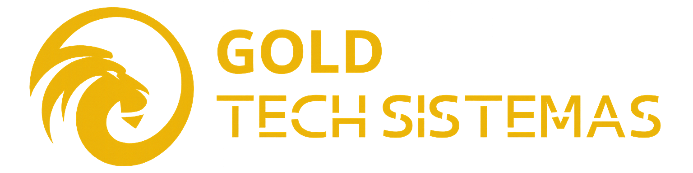
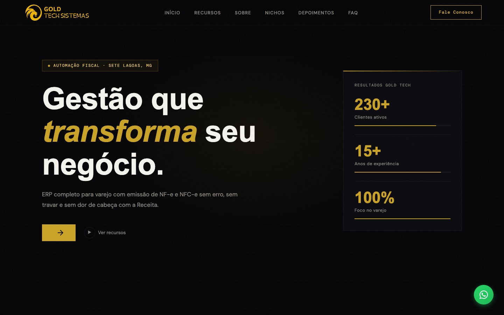
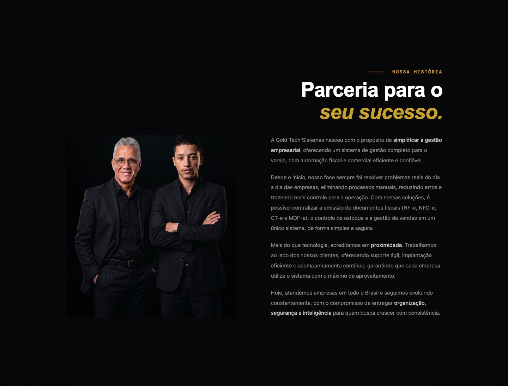
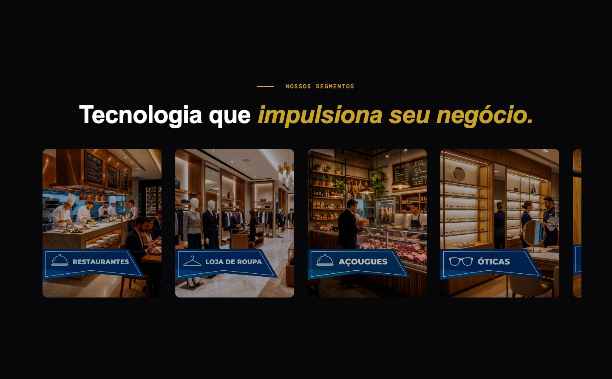
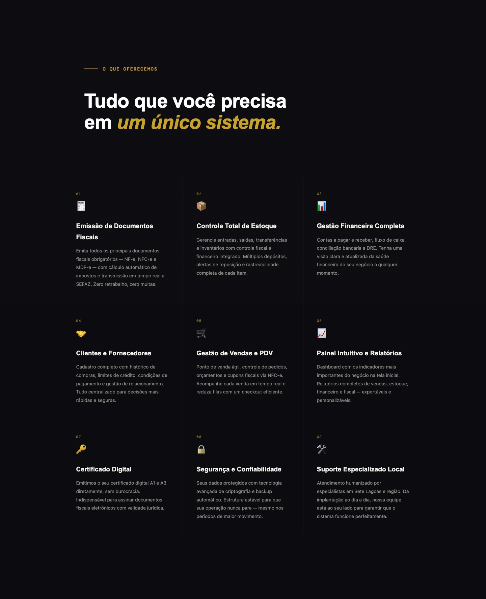
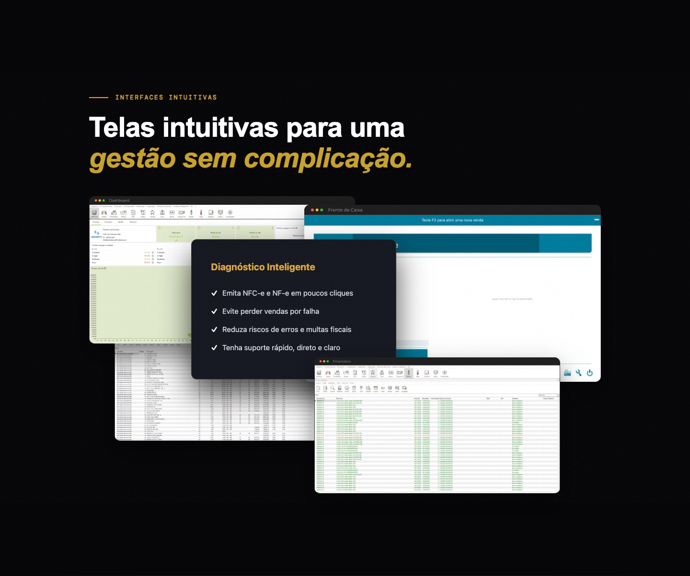
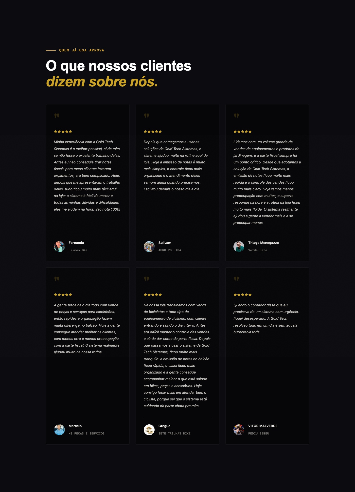
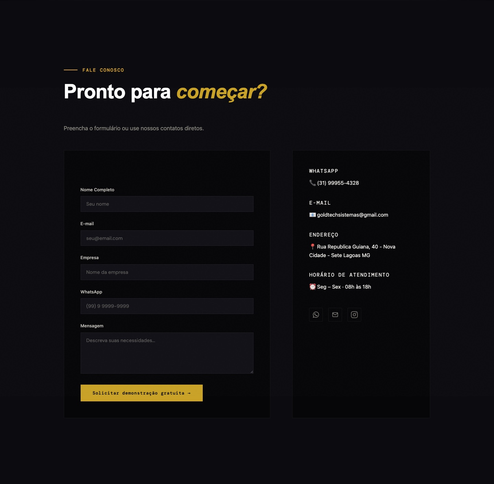
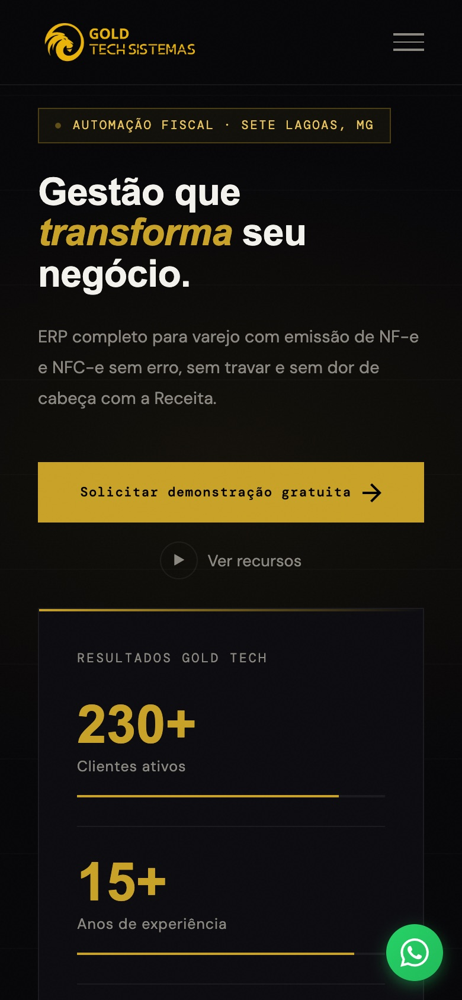

<div align="center">



# Gold Tech Sistemas — Website institucional

Site oficial da **Gold Tech Sistemas**, ERP completo para varejo com emissão de NF-e, NFC-e e MDF-e, sediado em Sete Lagoas, MG.

[](https://goldtechsistemas.vercel.app)


**[🌐 Ver site no ar](https://goldtechsistemas.vercel.app)**

</div>

<br />

<p align="center">
  
</p>

---

## Sumário

- [Sobre o projeto](#sobre-o-projeto)
- [Galeria](#galeria)
- [Funcionalidades](#funcionalidades)
- [Tecnologias](#tecnologias)
- [Estrutura de pastas](#estrutura-de-pastas)
- [Como rodar localmente](#como-rodar-localmente)
- [Personalização](#personalização)
- [Deploy](#deploy)
- [Créditos](#créditos)

---

## Sobre o projeto

Landing page institucional criada para apresentar a Gold Tech Sistemas e gerar contatos comerciais. O site mostra os recursos do ERP, os segmentos atendidos, telas reais do sistema e depoimentos de clientes, e leva o visitante a pedir uma demonstração pelo formulário ou pelo WhatsApp.

O projeto foi feito em **HTML, CSS e JavaScript puros**, sem frameworks nem etapa de build, o que deixa o site leve, rápido e fácil de manter.

---

## Galeria

<table>
  <tr>
    <td width="50%"></td>
    <td width="50%"></td>
  </tr>
  <tr>
    <td align="center"><b>Nossa história</b></td>
    <td align="center"><b>Segmentos atendidos</b></td>
  </tr>
  <tr>
    <td width="50%"></td>
    <td width="50%"></td>
  </tr>
  <tr>
    <td align="center"><b>Recursos do ERP</b></td>
    <td align="center"><b>Interfaces do sistema</b></td>
  </tr>
  <tr>
    <td width="50%"></td>
    <td width="50%"></td>
  </tr>
  <tr>
    <td align="center"><b>Depoimentos</b></td>
    <td align="center"><b>Contato</b></td>
  </tr>
</table>

### Versão mobile

<p align="center">
  
</p>

---

## Funcionalidades

**Seções da página**

| Seção | Conteúdo |
|---|---|
| **Hero** | Chamada principal, CTA de demonstração e contadores animados (clientes, anos de experiência) |
| **Sobre** | História e proposta de valor da empresa |
| **Nichos** | Carrossel automático com os segmentos atendidos (restaurantes, óticas, açougues, padarias etc.) |
| **Recursos** | Grade com os 9 módulos do ERP: fiscal, estoque, financeiro, PDV, relatórios e mais |
| **Clientes** | Carrossel com logos de clientes |
| **Interfaces** | Telas reais do sistema (dashboard, frente de caixa, financeiro) |
| **Depoimentos** | Avaliações de clientes com foto, nome e empresa |
| **Contato** | Formulário integrado ao Formspree e canais diretos (WhatsApp, e-mail, Instagram) |
| **FAQ** | Perguntas frequentes em formato acordeão |

**Interatividade**

- Layout responsivo do celular ao desktop grande
- Animações de entrada ao rolar a página (Intersection Observer)
- Carrosséis com rolagem automática e suporte a arrastar/deslizar
- Máscara automática no campo de telefone
- Menu mobile e barra de navegação que muda ao rolar
- Botão flutuante de WhatsApp

---

## Tecnologias

| Tecnologia | Uso |
|---|---|
| HTML5 | Estrutura semântica da página |
| CSS3 | Grid, Flexbox, variáveis CSS, animações e media queries |
| JavaScript (vanilla) | Carrosséis, contadores, máscara de telefone, menu e FAQ |
| [Google Fonts](https://fonts.google.com) | Playfair Display, DM Sans e DM Mono |
| [Formspree](https://formspree.io) | Recebimento dos envios do formulário por e-mail |
| [Vercel](https://vercel.com) | Hospedagem e deploy |

---

## Estrutura de pastas

```
.
├── index.html            # Página única do site
├── css/
│   └── styles.css        # Estilos e breakpoints responsivos
├── js/
│   └── script.js         # Interações da página
├── assets/               # Logo, favicon, fotos dos nichos, depoimentos e logos de clientes
└── docs/
    └── screenshots/      # Imagens usadas neste README
```

---

## Como rodar localmente

Não há dependências nem etapa de build.

```bash
git clone https://github.com/goldtechsistemas/Goldtechsistemas.git
cd Goldtechsistemas

# Opção 1: abrir direto no navegador
open index.html

# Opção 2: servidor local
npx serve .
```

---

## Personalização

**Cores:** a paleta fica nas variáveis CSS no início de `css/styles.css`:

```css
:root {
  --gold: #c9a227;        /* cor de destaque */
  --gold-light: #e8c45a;
  --bg: #060608;          /* fundo */
  --text: #f4f2ed;
}
```

**Textos e seções:** edite diretamente em `index.html`.

**Depoimentos:** edite os cards da seção `#depoimentos` em `index.html` e coloque a foto correspondente em `assets/`.

**Formulário:** troque o ID do Formspree no atributo `action` do formulário em `index.html`:

```html
<form action="https://formspree.io/f/SEU_ID" method="POST">
```

**Velocidade dos carrosséis:** ajuste a duração da animação `scrollCarousel` em `css/styles.css`.

---

## Deploy

O site está publicado na **Vercel**, em [goldtechsistemas.vercel.app](https://goldtechsistemas.vercel.app). Por ser um site estático, basta apontar a Vercel (ou qualquer hospedagem estática) para a raiz do repositório.

---

## Contato

| | |
|---|---|
| **WhatsApp** | (31) 99955-4328 |
| **E-mail** | goldtechsistemas@gmail.com |
| **Endereço** | Rua República Guiana, 40, Nova Cidade, Sete Lagoas, MG |
| **Atendimento** | Segunda a sexta, das 08h às 18h |

---

## Créditos

Site desenvolvido pela **Connect Dreams** para a Gold Tech Sistemas.

<div align="center">

<br />

© Gold Tech Sistemas. Todos os direitos reservados.

<sub>Desenvolvido por <b>Connect Dreams</b></sub>

</div>
